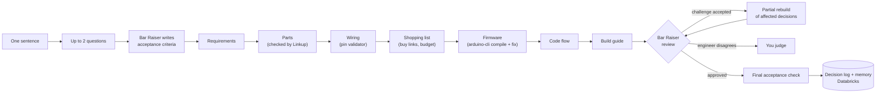

# Engineering Project Helper

**Describe an electronics project in one sentence. Get back everything you need to build it.**

> *"An ESP32 that waters my plant when the soil is dry"*

Engineering Project Helper is an autonomous agent that turns that sentence into a buildable ESP32 project:

- a **parts list** where every part is checked against live web sources, with buy links and a budget check
- a **breadboard layout** drawn from the validated pin map, so you can wire it hole by hole
- **firmware that compiles**, with an automatic fix loop when it doesn't
- a **code walkthrough**: click any line to have it explained, linked to a flow diagram
- a **step-by-step build guide** with a connection checklist, tests, safety notes and troubleshooting

Every choice the agent makes is recorded in a **versioned decision log with dependencies**. An independent
**Bar Raiser** (a second AI model from a different company) reviews the design, the engineer accepts or rejects
each challenge, and you get the final say on disagreements. Change anything ("use an LCD instead of the OLED")
and only what depends on it is rebuilt.

Built at the **Imperial AI Society Hackathon** (Autonomous Agents track).

---

## How it works



1. **Clarify.** The agent asks at most two essential questions (budget, power source…).
2. **Set the bar first.** Before any design exists, the Bar Raiser writes acceptance criteria from your request.
   The builder never sees them.
3. **Design.** Requirements → parts → wiring → shopping list → firmware → code flow → build guide. Each stage
   writes decisions to the log, each linked to the decisions it depends on.
4. **Independent review.** The Bar Raiser reviews the results blind, then reads the engineer's reasoning and keeps,
   downgrades or withdraws each challenge. The engineer accepts (→ partial rebuild, re-reviewed) or rejects with
   a reason.
5. **You decide.** Rejected high-severity challenges come to you: Bar Raiser right, engineer right, or neither.
6. **Honest delivery.** A final check scores every criterion on the finished design and lists every gap
   (unmet criteria, estimated prices, firmware not compiled…).
7. **Memory.** Approved projects become precedents. Similar future projects learn from what was built and from
   every mistake the reviewer caught.

## Features

| | |
|---|---|
| **Versioned decision log** | Every part, pin and design choice is a decision with a version, rationale, alternatives, evidence and dependencies. Nothing is overwritten: a change creates a new version. |
| **Partial rebuilds** | Change one decision and only its downstream is rebuilt; everything else keeps its version. The dependency graph shows exactly what a change will touch. |
| **Independent Bar Raiser** | A reviewer from a different AI company, with its own acceptance criteria, a two-step review and a final acceptance check. |
| **Live part verification** | Every non-passive part is checked with Linkup, and the sources are cited on the parts list. |
| **Real compilation** | Firmware is compiled with `arduino-cli` for the ESP32. Errors are fed back to the model until it compiles. |
| **Breadboard view** | A deterministic drawing generated from the validated pin map: transistors on the board, resistors laid straight, wires in tidy lanes. |
| **Interactive code** | Click or drag over lines to get an explanation; the matching step lights up in the flow diagram. |
| **Choose your models** | Pick the Engineer and the Bar Raiser separately: Claude, Gemini, Groq (free tiers work), or the offline demo. |
| **Improve a project** | Describe what you'd like changed; the feedback is mapped onto decisions and only those are rebuilt and re-reviewed. |

## Sponsor tracks

### Databricks: the agent's memory and audit trail

Every run is a growing record: dozens of decisions, each re-versioned whenever the Bar Raiser or the user
changes something, plus review rounds, outputs and memory. All of it lives in **Delta tables** in your
Databricks workspace, one table per kind of record:

| Delta table | What one row is |
|---|---|
| `eph_runs` | a project: prompt, models used, status, acceptance criteria, event log |
| `eph_decisions` | **one version of one decision** (part, pin, wiring, firmware…), with rationale, alternatives, evidence, confidence, the decisions it depends on, and the Bar Raiser's review |
| `eph_artifacts` | an output: parts list, cart, wiring and breadboard drawing, firmware, compile log, flow diagram, build guide |
| `eph_reviews` | one Bar Raiser review round: what was checked, challenged and why |
| `eph_precedents` | the agent's memory: an approved project, its embedding, and every mistake the reviewer caught |
| `eph_search_cache` | Linkup answers, reused for 7 days so reruns don't spend credits |
| `eph_explanations` | cached "explain this code" answers |

**How it works** (`eph/databricks_store.py`):

- **Nothing is ever overwritten.** A changed decision is a new row with `version + 1`; the old one is marked
  superseded. The full history of every choice, and of every partial rebuild, is queryable.
- **The agent never waits on the warehouse.** Writes go into a queue and a background thread flushes them every
  ~2 s as **one `MERGE` per table**. Several updates to the same record in that window collapse into one row
  write. Failed writes (for example while a serverless warehouse wakes up) stay queued and retry.
- **Survives restarts.** On startup the tables are read back, so every past project, its decision history and
  the agent's memory come back exactly as they were.
- **Visible in the app.** *Behind the build → Storage* shows **live row counts read from Databricks**, for all
  projects and for the open one, the sync status, and ready-to-run SQL with a Copy button.
- **Deleting a project deletes its rows** in every table.

Try it in the Databricks SQL editor:

```sql
-- the full decision history of one project, every version
SELECT get_json_object(doc, '$.key')                    AS decision,
       CAST(get_json_object(doc, '$.version') AS INT)   AS version,
       get_json_object(doc, '$.status')                 AS status,
       get_json_object(doc, '$.title')                  AS title
FROM workspace.eph.eph_decisions
WHERE get_json_object(doc, '$.run_id') = '<project id>'
ORDER BY decision, version;

-- everything the Bar Raiser challenged, across all projects
SELECT get_json_object(doc, '$.key')             AS decision,
       get_json_object(doc, '$.review.severity') AS severity,
       get_json_object(doc, '$.review.notes')    AS notes
FROM workspace.eph.eph_decisions
WHERE get_json_object(doc, '$.review.verdict') = 'challenge';
```

Setup takes three values (Free Edition works): `DATABRICKS_HOST` and `DATABRICKS_HTTP_PATH` from
*SQL Warehouses → your warehouse → Connection details*, and `DATABRICKS_TOKEN` from
*Settings → Developer → Access tokens*. The schema and tables are created automatically.

### Linkup: grounding every part in the real world

An LLM's memory of a part's pinout or voltage is a guess. Linkup turns it into evidence, at two points:

1. **Part verification (parts stage).** Every non-passive part gets a live Linkup `sourcedAnswer` search, using
   a query the parts model writes for it (for example *"DS18B20 waterproof probe pinout supply voltage"*). The
   searches run **in parallel**. Each answer and its top sources go to a verifier model, which uses only that
   evidence (plus well-established facts) to confirm pin names, supply voltage and logic level, and corrects
   the claim when the evidence disagrees. A part counts as verified only when the model confirms it **and**
   there are sources.
2. **Shopping list (procurement stage).** For each part, a second search (*"buy <model> UK price in stock"*)
   supplies the **buy link** and, when the answer states one, a **live price**. Anything without a live price is
   marked as an estimate, and the run's gap list says how many.

The sources are stored as **evidence on the decision itself** (URL, title, snippet, time retrieved), so they
travel with the decision log into Databricks. In the app, the parts list shows a summary such as
*"8 of 9 parts checked by Linkup · 14 web sources cited · 3 of 9 prices are live listings"* and, on each part,
the sites it was checked against (e.g. *"Checked by Linkup: adafruit.com · espressif.com"*) as clickable links. Results are cached for 7 days, so
rebuilds and reruns don't spend credits. Tavily is a drop-in fallback (`TAVILY_API_KEY`).

### MongoDB Atlas: alternative store

Set `MONGODB_URI` instead of the Databricks values and the same app runs on Atlas: the decision log, reviews,
artifacts and a TTL search cache are collections, and the agent's memory uses **Atlas Vector Search**
(`$vectorSearch` on the precedent embeddings, optionally from Voyage AI). `python scripts/init_atlas.py` creates
the vector index.

## Quick start

You need Python 3.11+. Everything works offline first, with no keys and no cost.

**Windows (Command Prompt)**
```bat
cd engineering-project-helper
python -m venv .venv
.venv\Scripts\activate
pip install -r requirements.txt
uvicorn eph.api:app --port 8001 --no-access-log
```

**macOS / Linux**
```bash
cd engineering-project-helper
python3 -m venv .venv && source .venv/bin/activate
pip install -r requirements.txt
uvicorn eph.api:app --port 8001 --no-access-log
```

Open **http://localhost:8001** and try an example. With no `.env` it runs the **offline demo**: canned answers,
no API calls.

### Real runs

1. Copy `.env.example` to `.env` and fill in what you have. Each is optional:

   | What | `.env` | Get it |
   |---|---|---|
   | AI models (at least one) | `ANTHROPIC_API_KEY`, `GEMINI_API_KEY`, `GROQ_API_KEY` | Gemini and Groq have free tiers, no card needed |
   | Live part checks | `LINKUP_API_KEY` | [app.linkup.so](https://app.linkup.so) |
   | Databricks storage | `DATABRICKS_HOST`, `DATABRICKS_HTTP_PATH`, `DATABRICKS_TOKEN` | SQL Warehouses → Connection details; Settings → Developer → Access tokens |
   | Turn off the demo | `EPH_MOCK=0` | |

2. Install the ESP32 compiler (optional, enables real compiles):
   - Windows: `python scripts\setup_arduino_windows.py`. It finds or installs `arduino-cli` and the ESP32 core,
     and reuses the copy inside the Arduino IDE if you have it.
   - macOS / Linux: `./scripts/setup_arduino.sh`

3. Check everything: `python scripts/check_setup.py`. It tests every key and service and tells you how to fix
   anything that fails.

4. Restart the server, open the app, pick an **Engineer** and an **Independent reviewer**, and build.

## Using the app

| Section | What's there |
|---|---|
| **Build guide** | What it is and how it works, numbered build steps, a connection checklist, test & calibrate, safety, troubleshooting |
| **Parts & budget** | Every part with specs, how it was verified (with sources), price and a buy link |
| **Connections** | The breadboard picture, the pin map, support components, the pin validator |
| **Code & logic** | The firmware linked to its flow diagram; click a line for an explanation |
| **Review & refine** | Acceptance criteria, the Bar Raiser's review, disagreements for you to judge, gaps, and the improve box |
| **Behind the build** | Decision log, agent activity, dependency graph, memory, and storage (live Databricks counts + SQL) |

## Tech stack

| Layer | Choice | Why |
|---|---|---|
| Backend | Python, FastAPI | Simple, fast to build; the whole pipeline is plain Python |
| Agents | Anthropic Claude, Google Gemini, Groq via one tool-calling interface | Structured outputs everywhere; builder and reviewer can be different companies |
| Storage | Databricks Delta tables (or MongoDB Atlas, or in-memory) | Every version of every decision is kept and queryable with SQL |
| Search | Linkup (Tavily fallback) | Sourced answers with citations for part verification and buy links |
| Compiler | arduino-cli + ESP32 core | Proof that the firmware builds, not just that it looks right |
| Frontend | One HTML file, Mermaid for diagrams | No build step; runs anywhere the server runs |

## Project structure

```
eph/
  pipeline.py          the run: stages, review loop, partial rebuilds, final check
  stages/              requirements, parts, wiring, procurement, firmware, diagram, guide
  bar_raiser.py        independent reviewer: criteria, blind review, final acceptance
  engineer.py          accepts / rejects challenges, maps feedback onto decisions
  db.py                the versioned decision log (dependencies, stale detection, downstream)
  databricks_store.py  Databricks backend: write-behind mirror into Delta tables
  precedents.py        memory: similar past projects and their mistakes
  breadboard.py        breadboard drawing from the pin map
  llm.py, models.py    model providers and the model menu
  api.py               HTTP API used by the web app
web/index.html         the app
scripts/               setup checker, Arduino setup, Atlas setup
tests/                 offline tests (pytest)
docs/                  technical notes, decision log schema
```

## Tests

```bash
pytest -q
```

The suite runs fully offline with a mock model, mock search and an in-memory database. It covers the full
pipeline, partial rebuilds, review and verdicts, the Databricks backend against a fake warehouse, provider quirks
(rate limits, timeouts, cut-off answers) and the breadboard layout.

## Limitations

- Targets the ESP32 DevKit V1 (WROOM-32); the pin rules are specific to it.
- Generated designs are for low-voltage hobby circuits. Check current draw and power before connecting motors
  or pumps.
- Firmware is compiled, not run on hardware: test on the bench before relying on it.
- A full real run makes around 25 model calls, so free tiers allow a handful of runs per day.

## More detail

- [Technical notes](docs/TECHNICAL.md): how each stage, the Bar Raiser, partial rebuilds, memory and the
  API work
- [Decision log schema](docs/SCHEMA.md)

---

Built by Joyce and Eric at the Imperial AI Society Hackathon, November 2026.
